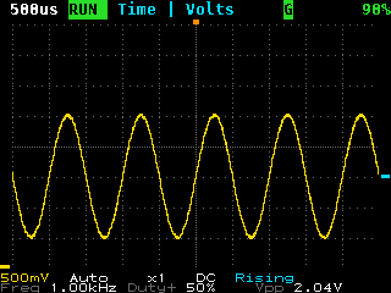
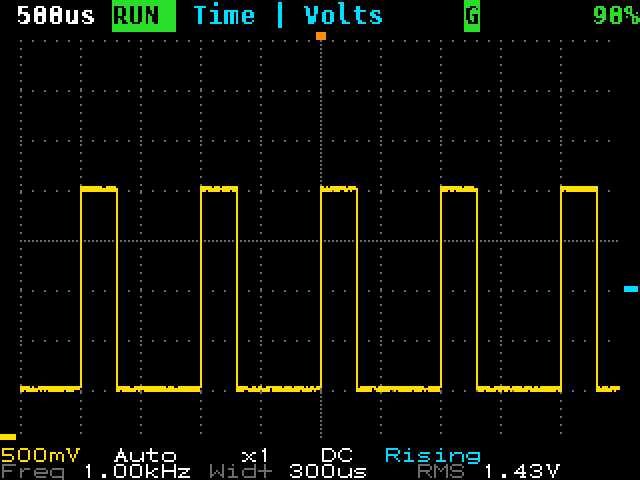
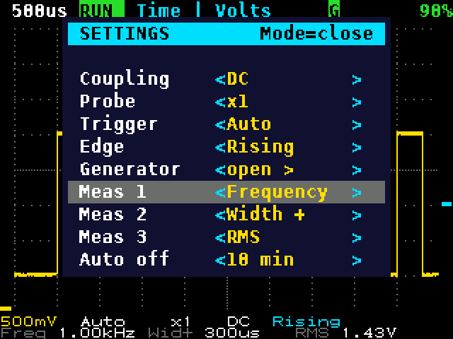
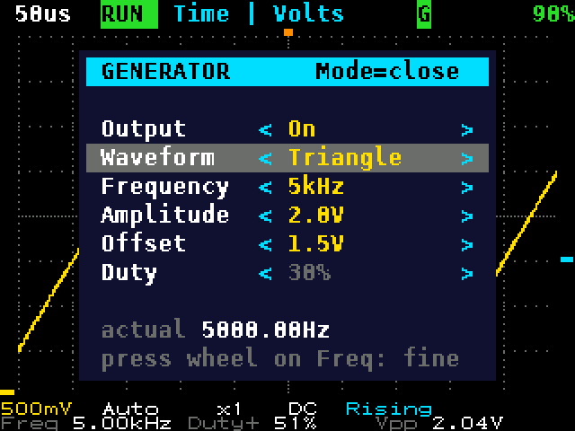
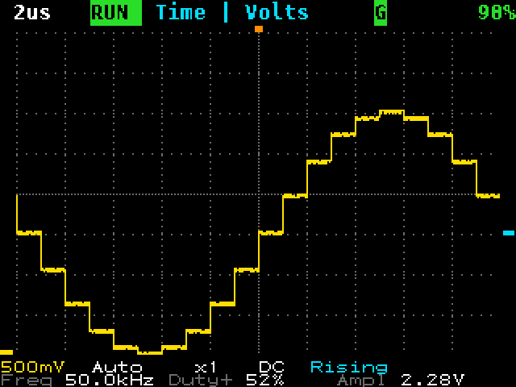
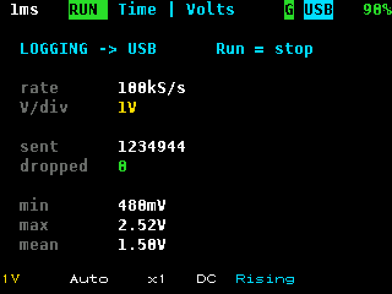

# DSO-510 open firmware

Replacement firmware for the **FNIRSI DSO-510** handheld oscilloscope + signal generator, written from
scratch in C. It keeps what the stock firmware does well and adds what it lacks:

- **CSV export** instead of BMP screenshots: long-press Run and the capture lands on the scope's USB drive as
  a CSV file (time, volts, raw ADC code), with the settings in a header.
- **USB drive that just mounts**: plug the scope in and the drive appears; no menu to enter first.
- **Live USB streaming** to a PC: whole frames, or a gap-free logger at 1 kS/s ... 500 kS/s, with a live
  plotter and CSV recording ([`tools/`](tools/README.md)).
- **Scope and generator at the same time**: 9 waveforms, 1 Hz ... 50 kHz, 0.1 ... 3.0 Vpp, offset and duty.
- **Real-time 24 / 48 MS/s** capture (four interleaved DMA streams) and the 50 / 100 / 200 ns/div timebases.
- **12 measurements**, any three shown at once in the bottom bar.
- **Settings remembered** across power-off, including the auto-zero result; auto shutdown (5 / 10 / 30 min).

The FNIRSI bootloader and the factory calibration are never touched, so you can always go back to the stock
firmware (see [Going back to stock](#going-back-to-stock)).

## Screens

These images are rendered on a PC by the firmware's own drawing code (see [`sim/`](#screen-emulator)), so they
show exactly what the LCD shows, without the glare of a photo. Photos of the real device are in
[`docs/photos/`](docs/photos/).

| | |
|---|---|
|  |  |
| 1 kHz sine from the built-in generator | Square wave; the three measurement slots set to Freq / Width+ / RMS |
|  |  |
| Settings menu (long-press Mode) | Generator page (menu → Generator) |
|  |  |
| 50 kHz at 2 µs/div, 48 MS/s (the generator's 20 DAC steps are visible) | Logger status while a PC records over USB |

## Installing

1. Download [`firmware/APP_DSO-510_app.bin`](firmware/APP_DSO-510_app.bin) (or the file attached to the latest
   [release](../../releases)).
2. Switch the scope off. Hold the **firmware update button** and press **Power**. The scope appears on your PC
   as a USB drive named `DSO-510` containing `Ready.TXT`.
3. Copy the `.bin` file onto that drive. The scope flashes it, disconnects, and starts the new firmware.

On Linux, [`tools/flash.sh`](tools/flash.sh) waits for the update drive and copies the file for you:
`tools/flash.sh firmware/APP_DSO-510_app.bin`.

### Going back to stock

Download the stock firmware from FNIRSI's website and install it the same way (update button + Power, copy
the file). The stock firmware's own settings and calibration are untouched by this firmware.

## Using it

| Key | Short press | Long press |
|---|---|---|
| **Mode** | cycle what the wheel and Up/Down control: Time \| Volts → TrigPos \| Offset → TrigPos \| Level → Gen Freq \| Amp | open / close the settings menu |
| **Wheel** left/right | timebase, trigger position or generator frequency (per the mode above) | |
| **Up / Down** | V/div, offset, trigger level or generator amplitude | |
| **Wheel press** | in Gen mode: fine frequency steps (`~`) | |
| **Run** | run / stop | save the capture as CSV |
| **Auto** | auto-set (timebase, V/div, offset, trigger for the input signal) | auto-zero (short the probe first) |
| **Power** | | switch off |

- **Top bar**: timebase, RUN/STOP, the current control mode, `G` while the generator output is on, `USB` while
  a PC streams frames, battery. A red `!` means the scope has no factory calibration and has not been auto-zeroed.
- **Bottom bar**: V/div, trigger mode, probe, coupling, edge; below it the three measurements.
- **Settings menu**: coupling, probe ×1/×10, trigger mode (Auto / Normal / Single), edge, the generator page,
  the three measurement slots (frequency, period, duty ±, pulse width ±, max, min, peak-peak, amplitude, RMS,
  average) and auto shutdown.
- **Generator page**: output on/off, waveform (sine, square, triangle, sawtooth, DC, half-wave, full-wave,
  exponential rise / fall), frequency, amplitude, offset (DC: level), duty (square). The `actual` line shows the
  frequency the hardware really produces.
- Settings are saved when you switch off with the Power key (file `DSO510.CFG` on the drive; delete it to get
  the defaults back). They are not saved if the battery runs flat or the PC is using the drive at that moment.

## CSV files

Long-press **Run** saves the capture on screen to `CSV/CAP0001.CSV`, `CAP0002.CSV`, ... on the scope's drive
(5 MB, room for about 45 captures). If the PC has the drive mounted, the scope briefly disconnects while it writes,
then reconnects. A capture is 4800 samples (four screens), with time 0 at the trigger point:

```
# DSO-510 custom firmware 1.0.0
# sample_rate_hz=600000
# volts_per_div=0.5000
# coupling=DC
# probe=1
# trigger=Auto,rising,1.5000
# trigger_index=1200
# triggered=1
# cal=offset_pwm=1651,volts_per_code=0.020000
time_s,volts,adc_code
-0.002000000,2.4800,177
-0.001998333,2.5200,179
...
```

### Plotting a CSV

[`plot_csv.py`](plot_csv.py) plots one or more captures with matplotlib:

```sh
pip install matplotlib
python3 plot_csv.py CAP0001.CSV                       # opens a window
python3 plot_csv.py CAP0001.CSV CAP0002.CSV           # overlay several
python3 plot_csv.py CAP0001.CSV --save capture.png    # write an image instead
python3 plot_csv.py CAP0001.CSV --codes               # raw ADC codes instead of volts
```

The trigger point (t = 0) and the trigger level are marked; the legend shows each file's sample rate, V/div
and coupling.

## Live streaming to a PC

The scope is also a USB serial port. [`tools/scope_live.py`](tools/README.md) shows the live trace or a
continuous log and can record CSV files; the protocol is documented in
[`tools/README.md`](tools/README.md) and implemented without dependencies in `tools/dsoproto.py`.

## Building from source

Needs `arm-none-eabi-gcc` (any recent version) and `make`; the tests need a host C compiler.

```sh
make -C fw            # firmware: fw/build/APP_DSO-510_app.bin
make -C tests         # host unit tests (no hardware needed)
python3 -m unittest discover -s tools/tests
```

`make -C fw everything` also builds the small hardware test apps in `fw/apps/` (key test, flash test, the
interleave bench, ...); each is installed the same way and every one of them powers off with a long Power press.

### Screen emulator

`make -C sim` builds the firmware's UI code (`fw/app/ui.c` and `fw/core/`) for the PC, feeds it the generator's
own waveform tables sampled like the real ADC, and writes the screenshots above to `docs/screens/`
(needs Python with Pillow for the PNG step).

## Repository layout

| Path | What |
|---|---|
| `fw/app/` | the scope application (main loop, UI, CSV save, USB streaming) |
| `fw/core/` | hardware-independent logic, all host-tested (trigger, measurements, generator maths, settings, USB protocol, ...) |
| `fw/common/` | drivers: LCD, ADC capture (single and interleaved), front end, DAC generator, SPI flash, USB device |
| `fw/storage/` | FAT volume on the SPI flash (FatFs), capture and settings files |
| `fw/third_party/fatfs/` | FatFs R0.15a by ChaN |
| `tests/` | host unit tests and protocol test vectors |
| `tools/` | PC tools: live plotter, serial client, protocol library, flash helper |
| `sim/` | screen emulator for the README images |
| `firmware/` | ready-to-flash binary |
| `docs/` | screenshots, photos, and the design notes (`docs/superpowers/specs/`) |
| `NOTES.md` | reverse-engineering notes and hardware test results |

## Hardware notes

Artery AT32F403A at 240 MHz, external 8-bit ADC (3PEAK 3PA1030) on GPIOB, ST7789 320×240 LCD, 8 MB SPI NOR
flash (5 MB user drive), USB full speed. The pin map, timer and DMA usage, and what was learned from the stock
firmware are in [`NOTES.md`](NOTES.md).

Known limitations: about 1 % of 48 MS/s frames have one stream sampled 20 ns late (a bus-timing limit of the
chip); at 24 / 48 MS/s an isolated one-sample spike is filtered out, which would also remove a genuine 20 ns
pulse; file timestamps are fixed because the scope has no clock. Tested on Linux only.

## Licence

MIT — see [LICENSE](LICENSE). FatFs (`fw/third_party/fatfs/`) and the 8×8 font (`fw/common/font8x8.h`) carry
their own permissive notices. This project is not affiliated with FNIRSI.
